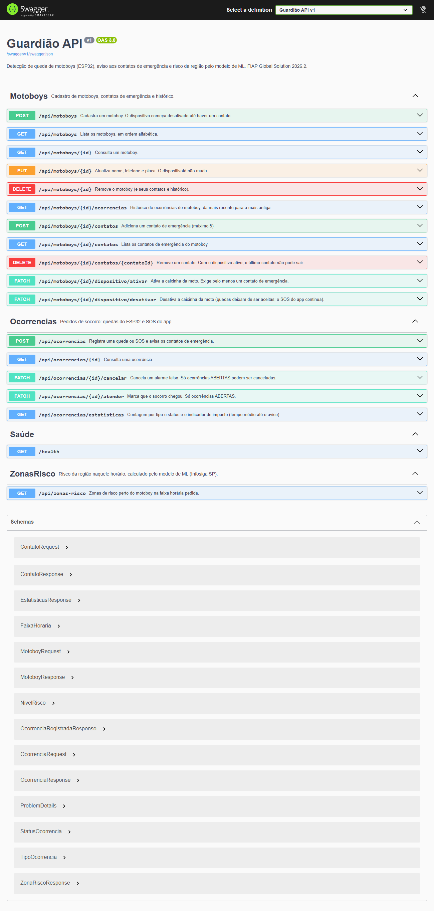
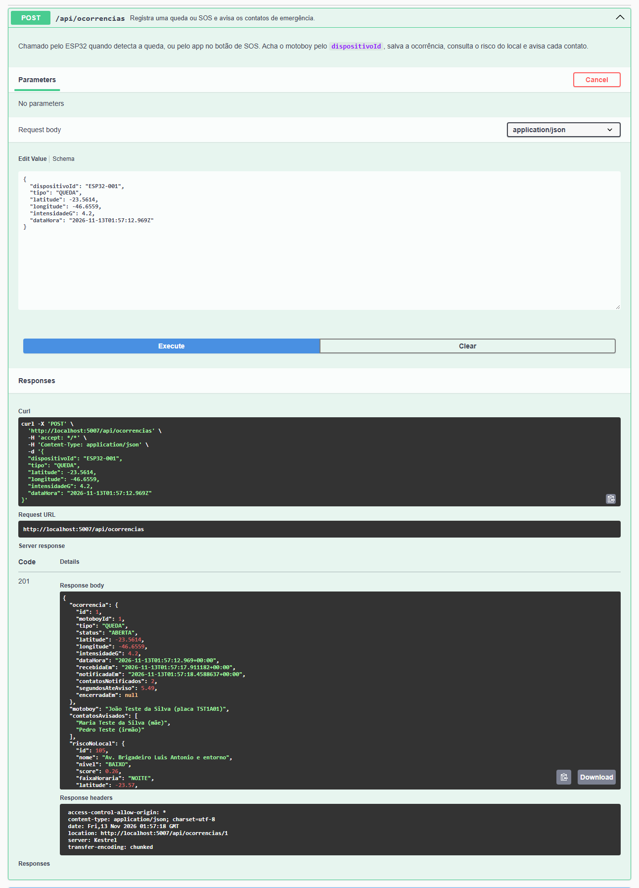
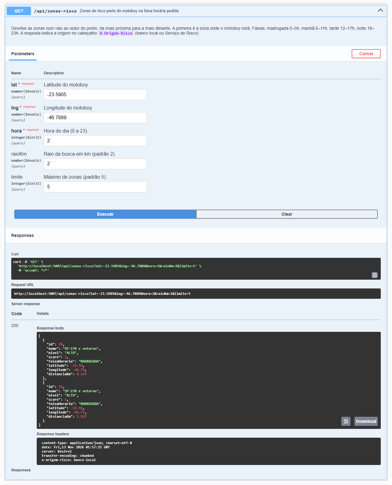
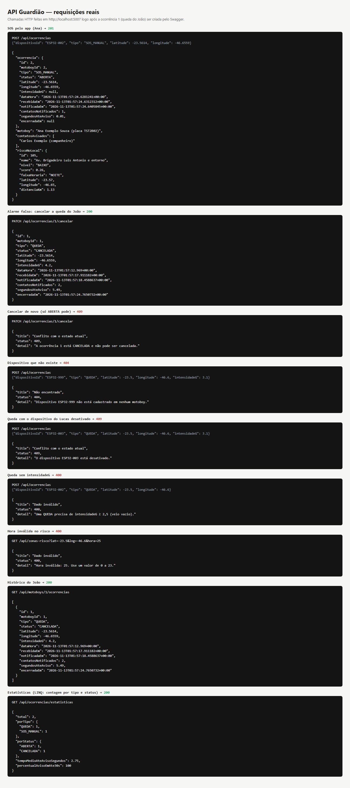
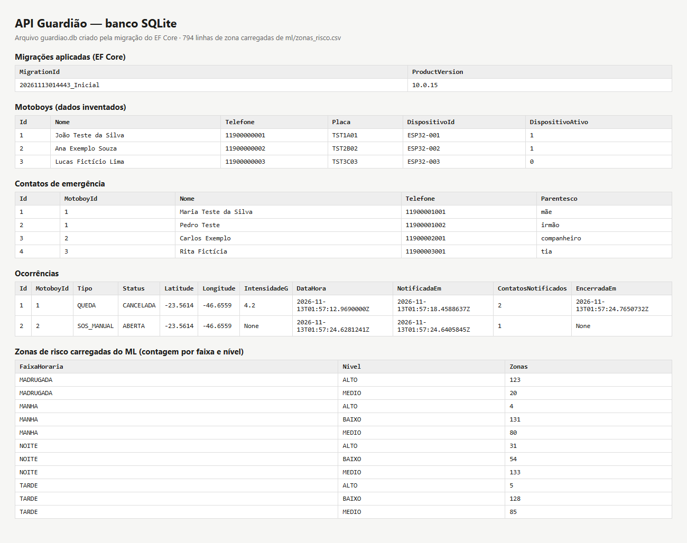
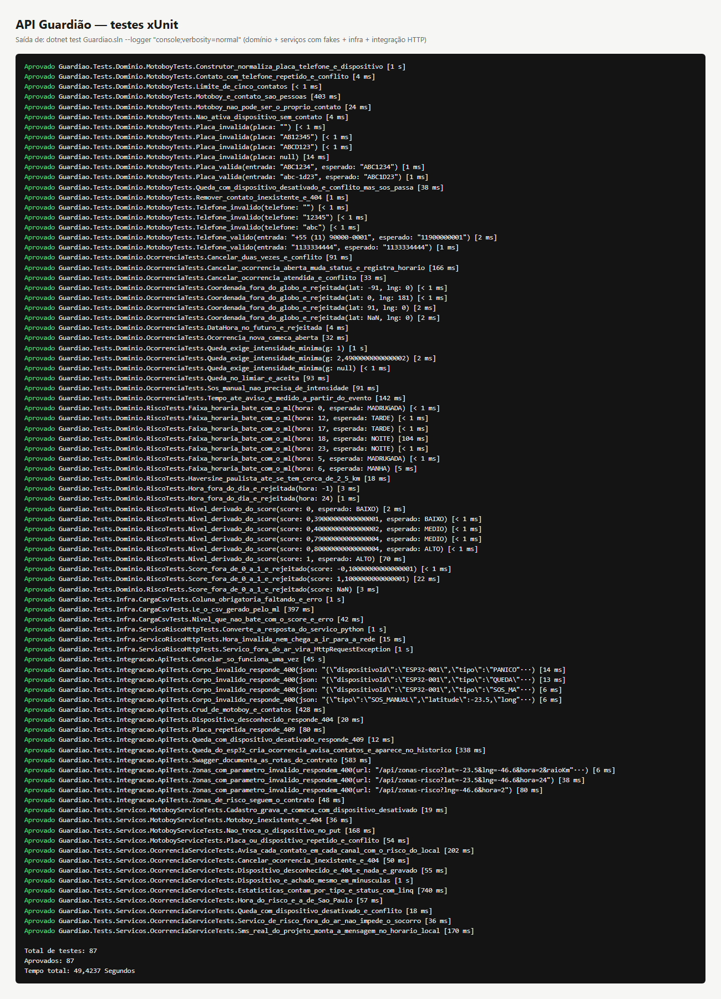
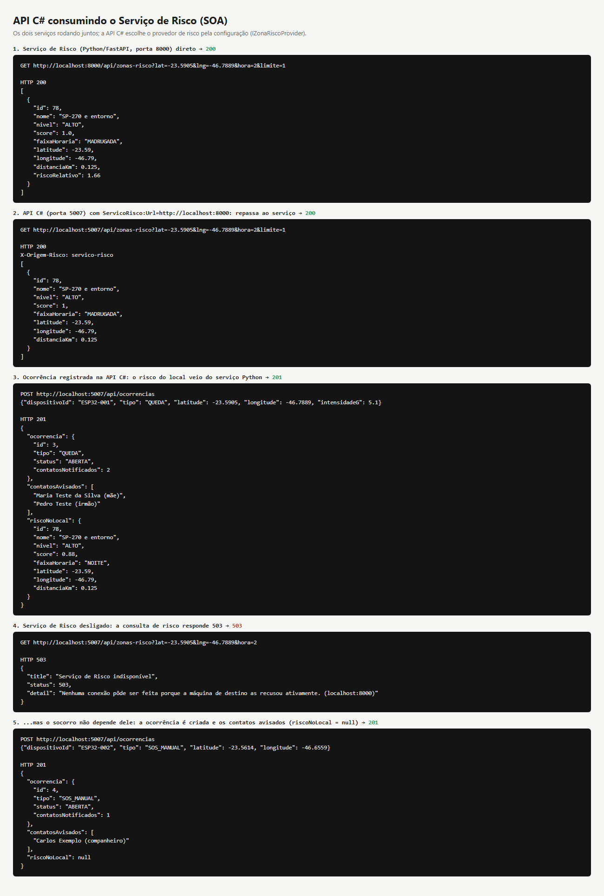

# Guardião: API em C#

> **Integrantes:** Arthur Abonizio (RM555506) · Gabriel Padula (RM554907) · Rodrigo Nakata (RM556417)

API REST do Guardião. Ela recebe a queda detectada pelo ESP32 (ou o SOS do app), acha o motoboy pelo dispositivo,
grava a ocorrência e avisa cada contato de emergência. Também diz o risco da região naquele horário, usando o
modelo de ML.

ASP.NET Core 10 · EF Core 10 + SQLite · Swagger · xUnit (87 testes).

## Ficha da CitizenTech

| Campo | Resposta |
|---|---|
| **Nome** | Guardião |
| **Cidadão beneficiado** | Entregador de moto (motoboy) que trabalha por aplicativo em São Paulo |
| **Problema, em uma frase** | O motoboy não sabe onde o risco é maior e, quando cai, o socorro demora porque ninguém é avisado. |
| **Como funciona** | Uma caixinha na moto percebe a queda e pede socorro sozinha; o app avisa quais regiões são perigosas naquele horário. |
| **Papel desta API** | Cadastro de motoboys e contatos, registro de quedas/SOS, aviso aos contatos e consulta de risco por região |
| **Indicador de impacto** | Tempo entre a queda e o aviso ao contato (meta: menos de 30 s), medido em `GET /api/ocorrencias/estatisticas` |
| **ODS** | 3 (meta 3.6), 9 e 11 |

A ficha completa está no [README principal](../README.md).

## Como rodar

Pré-requisito: [.NET SDK 10](https://dotnet.microsoft.com/download/dotnet/10.0).

```bash
cd guardiao/api
dotnet tool restore
dotnet run --project Guardiao.Api
```

Depois abra **http://localhost:5007/swagger**.

Na primeira execução, a API faz três coisas sozinha:
1. aplica a migração do EF Core e cria o `guardiao.db` (SQLite);
2. carrega as 794 linhas de [`ml/zonas_risco.csv`](../ml/zonas_risco.csv), geradas pelo modelo de ML;
3. cria 3 motoboys de demonstração. Os dados são **inventados**, nenhum dado pessoal é real.

| Motoboy | Dispositivo | Contatos | Caixinha |
|---|---|---|---|
| João Teste da Silva | `ESP32-001` | 2 | ativa |
| Ana Exemplo Souza | `ESP32-002` | 1 | ativa |
| Lucas Fictício Lima | `ESP32-003` | 1 | **desativada** (serve para demonstrar a regra) |

Rodar os testes:

```bash
dotnet test
```

Migrações (opcional, porque a API já migra ao iniciar):

```bash
dotnet ef migrations add NomeDaMigracao -p Guardiao.Infrastructure -s Guardiao.Api -o Dados/Migracoes
```

```bash
dotnet ef database update -p Guardiao.Infrastructure -s Guardiao.Api
```

### Usando o Serviço de Risco (SOA)

Por padrão, o risco vem do banco da própria API. Para a API consultar o
[Serviço de Risco em Python](../servico-risco/README.md), suba o serviço na porta 8000 e informe a URL:

```bash
ServicoRisco__Url=http://localhost:8000 dotnet run --project Guardiao.Api
```

O cabeçalho `X-Origem-Risco` de `GET /api/zonas-risco` mostra de onde veio a resposta: `banco-local` ou
`servico-risco`. Se o serviço cair, a consulta de risco responde 503, mas **o socorro continua**: a ocorrência é
gravada e os contatos são avisados, só que sem a informação de risco.

### Configuração (`appsettings.json`)

| Chave | Padrão | Para quê |
|---|---|---|
| `ConnectionStrings:Guardiao` | `Data Source=guardiao.db` | Banco SQLite |
| `ZonasRisco:CsvPath` | `../../ml/zonas_risco.csv` | CSV do ML carregado na primeira execução |
| `ServicoRisco:Url` | vazio | Se preenchido, o risco vem do Serviço de Risco por HTTP |
| `Notificacao:Canais` | `["log","sms"]` | Canais de aviso ativos (o SMS é simulado) |
| `Demo:CriarMotoboys` | `true` | Cria os 3 motoboys de demonstração |

## Endpoints

| Método | Rota | O que faz |
|---|---|---|
| POST | `/api/ocorrencias` | Registra queda (ESP32) ou SOS (app) e avisa os contatos |
| GET | `/api/ocorrencias/{id}` | Consulta uma ocorrência |
| PATCH | `/api/ocorrencias/{id}/cancelar` | Cancela um alarme falso (só se estiver ABERTA) |
| PATCH | `/api/ocorrencias/{id}/atender` | Marca que o socorro chegou (só se estiver ABERTA) |
| GET | `/api/ocorrencias/estatisticas` | Contagem por tipo e status e o tempo médio até o aviso |
| GET | `/api/zonas-risco?lat=&lng=&hora=` | Zonas de risco perto do ponto, naquela faixa horária: `[{id, nome, nivel, score, ...}]` |
| POST · GET | `/api/motoboys` | Cadastra · lista motoboys |
| GET · PUT · DELETE | `/api/motoboys/{id}` | Consulta · atualiza · remove |
| GET | `/api/motoboys/{id}/ocorrencias` | Histórico do motoboy, da mais recente para a mais antiga |
| POST · GET | `/api/motoboys/{id}/contatos` | Adiciona (máximo 5) · lista contatos de emergência |
| DELETE | `/api/motoboys/{id}/contatos/{contatoId}` | Remove contato |
| PATCH | `/api/motoboys/{id}/dispositivo/ativar` · `desativar` | Liga ou desliga a caixinha da moto |

Exemplo do corpo de `POST /api/ocorrencias` (o mesmo combinado com o ESP32 e o app):

```json
{ "dispositivoId": "ESP32-001", "tipo": "QUEDA", "latitude": -23.5614, "longitude": -46.6559,
  "intensidadeG": 4.2, "dataHora": "2026-11-15T23:41:00-03:00" }
```

Erros seguem o padrão ProblemDetails (RFC 9457), com mensagem em português:

| Código | Quando |
|---|---|
| 400 | Dado inválido: QUEDA sem `intensidadeG` ≥ 2,5, coordenada fora do globo, hora 25, placa ou telefone inválido, `dataHora` no futuro |
| 404 | Dispositivo, motoboy, contato ou ocorrência não existe |
| 409 | Conflito com o estado atual: cancelar ocorrência que não está aberta, queda com a caixinha desativada, placa repetida, sexto contato, ativar sem contato |
| 503 | Serviço de Risco fora do ar (só na consulta de risco) |

## Como o código está organizado

```
api/
├── Guardiao.Domain/          ← regras de negócio, sem nada de banco ou HTTP
│   ├── Entidades/            ← Pessoa (abstrata), Motoboy, ContatoEmergencia, Ocorrencia, ZonaDeRisco
│   ├── Servicos/             ← OcorrenciaService, MotoboyService (casos de uso)
│   ├── Interfaces.cs         ← IMotoboyRepository, IOcorrenciaRepository, IZonaRiscoProvider, INotificador
│   └── Enums.cs, Excecoes.cs, Fuso.cs
├── Guardiao.Infrastructure/  ← o que fala com o mundo de fora
│   ├── Dados/                ← DbContext (EF Core), repositórios, migrações, carga inicial do CSV
│   ├── Risco/                ← provedor de risco: banco local ou Serviço de Risco via HTTP
│   └── Notificacao/          ← NotificadorLog e NotificadorSms
├── Guardiao.Api/             ← controllers, DTOs, DI, Swagger, tradução de erros para HTTP
├── Guardiao.Tests/           ← xUnit: domínio, serviços com fakes, infra e integração HTTP
└── docs/evidencias/          ← prints
```

O controller só traduz HTTP. A regra fica no domínio. Por exemplo, "só ocorrência ABERTA pode ser cancelada"
está em [`Ocorrencia.Cancelar`](Guardiao.Domain/Entidades/Ocorrencia.cs), e não no controller.

### Onde está cada tópico da disciplina

| Tópico | Onde ver |
|---|---|
| **Abstração e herança** | `Pessoa` é abstrata (nome, telefone, validação e `Descricao()`); `Motoboy` e `ContatoEmergencia` herdam dela ([Pessoa.cs](Guardiao.Domain/Entidades/Pessoa.cs)). `NotificadorBase` é a base abstrata dos notificadores. |
| **Encapsulamento** | Os setters são privados e o estado só muda por métodos com regra: `Cancelar()`, `AdicionarContato()`, `AtivarDispositivo()`. As listas de contatos e ocorrências são privadas; o lado de fora só lê ([Motoboy.cs](Guardiao.Domain/Entidades/Motoboy.cs)). |
| **Polimorfismo** | `Descricao()` sobrescrita em cada `Pessoa`. `INotificador` tem duas implementações (`NotificadorLog` e `NotificadorSms`), e o serviço avisa por todas sem saber quais são. `IZonaRiscoProvider` também tem duas: banco local ou Serviço de Risco via HTTP. |
| **Interfaces + DI** | Interfaces em [Interfaces.cs](Guardiao.Domain/Interfaces.cs), registradas em [Configuracao.cs](Guardiao.Api/Configuracao.cs). A implementação de risco é escolhida pela configuração. `TimeProvider` também é injetado, para os testes controlarem o relógio. |
| **EF Core** | [GuardiaoDbContext](Guardiao.Infrastructure/Dados/GuardiaoDbContext.cs) com 4 tabelas, relacionamentos 1:N com cascade, índices únicos (placa, dispositivo), enums gravados como texto e migração `Inicial`. |
| **LINQ** | Ocorrências por data (`OrderByDescending`), contagem por tipo e status (`GroupBy` → `ToDictionaryAsync`) e tempos até o aviso em [Repositorios.cs](Guardiao.Infrastructure/Dados/Repositorios.cs). Zonas por faixa e distância (`Where` no banco + `OrderBy` pela distância) em [ProvedoresDeRisco.cs](Guardiao.Infrastructure/Risco/ProvedoresDeRisco.cs). |
| **async/await** | Do controller ao banco e ao HTTP, tudo é `async` com `CancellationToken`. |
| **REST** | Verbos e códigos certos (201 com `Location`, 204, 400/404/409), ProblemDetails e Swagger com exemplos e descrição de cada resposta. |
| **Testes** | 87 testes xUnit (veja abaixo). |

### Testes

| Grupo | O que cobre |
|---|---|
| `Dominio/` | Cancelar só quando ABERTA (e não cancelar duas vezes), limiar de queda 2,5 g, coordenadas, data no futuro, placa antiga e Mercosul, telefone, limite de 5 contatos, ativar sem contato, faixa horária e nível de risco iguais aos do ML |
| `Servicos/` | Com repositórios **fake** em memória: dispositivo desconhecido → 404 sem gravar nada; avisa cada contato em cada canal; hora do risco no fuso de São Paulo; Serviço de Risco fora do ar não impede o socorro |
| `Infra/` | Leitura do CSV real do ML (794 linhas, 222 zonas) e o cliente HTTP do Serviço de Risco contra um servidor simulado |
| `Integracao/` | A API inteira (`WebApplicationFactory` + SQLite temporário): POST de queda → 201 → GET → histórico; 400/404/409; contrato de `/api/zonas-risco`; CRUD de motoboy; rotas do contrato no Swagger |

Os testes acharam um bug de verdade durante o desenvolvimento: uma coordenada `NaN` passava pela validação. O bug
foi corrigido em `Ocorrencia`.

## Evidências

Todas as imagens são da API rodando de verdade (`docs/evidencias/`).

**Swagger:** visão geral das rotas



**Ocorrência sendo criada pelo Swagger:** queda do ESP32-001 → 201, 2 contatos avisados, risco do local



**Risco da região:** zona 78 (SP-270), madrugada, nível ALTO



**Regras pelo HTTP:** SOS, cancelar (200 e depois 409), dispositivo desconhecido (404), caixinha desativada (409),
dados inválidos (400), histórico e estatísticas



**Banco SQLite** depois das chamadas: migração aplicada, motoboys, contatos, ocorrências e zonas do ML



**Testes:** 87 aprovados



**SOA:** a API C# consultando o Serviço de Risco em Python e continuando a socorrer quando ele cai


