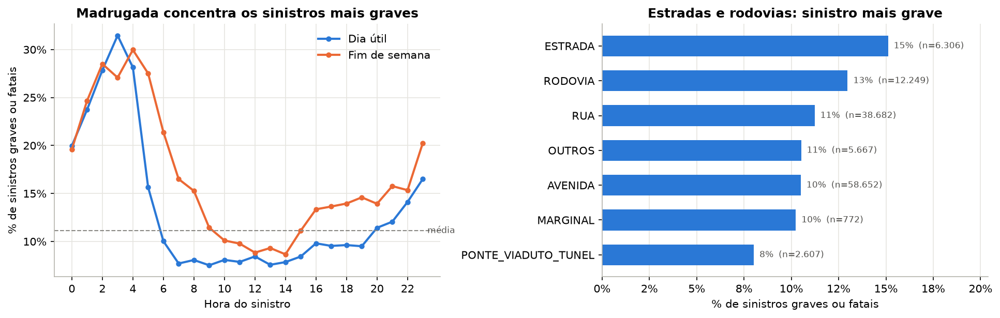
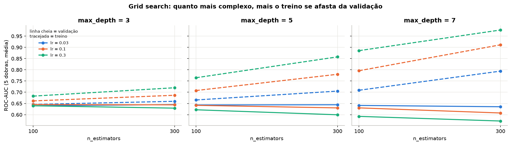
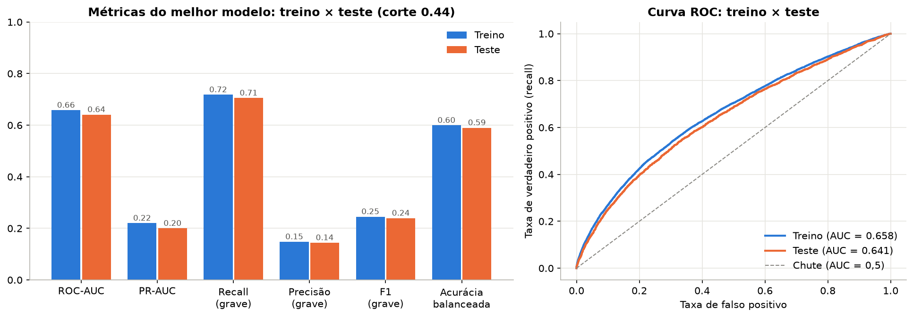
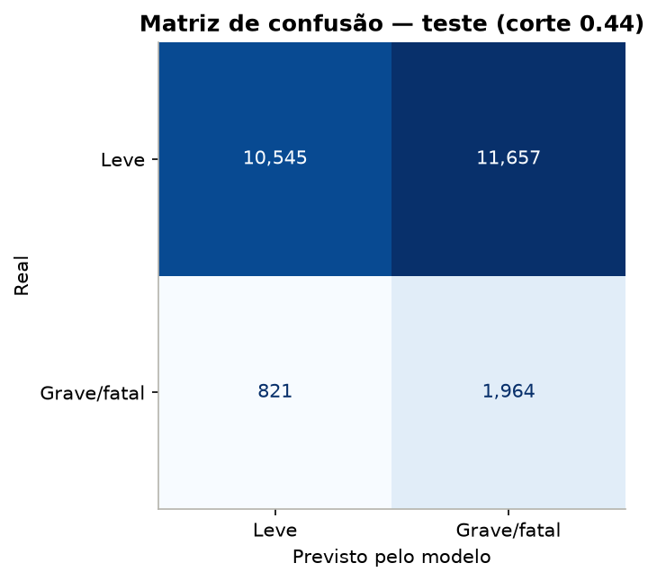
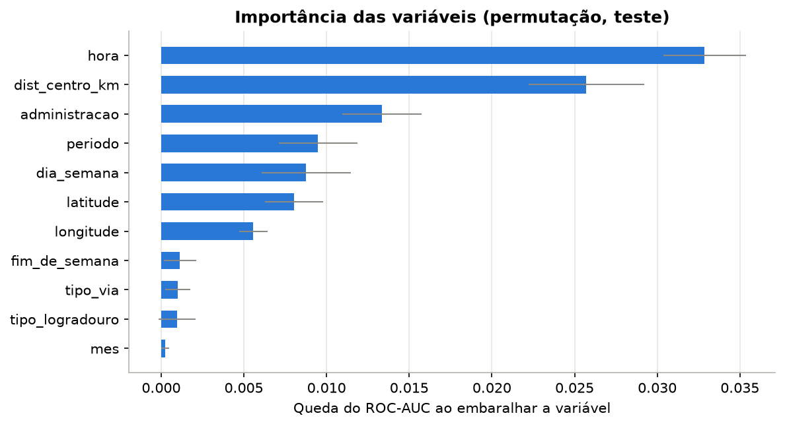
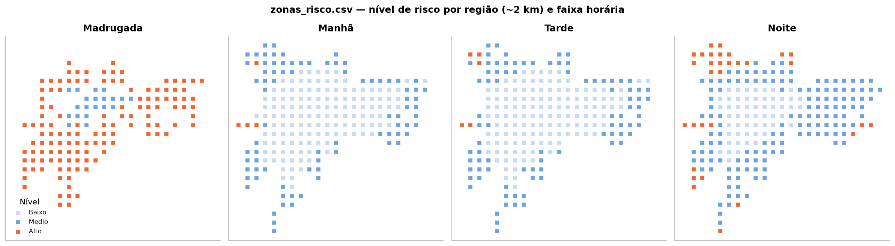

# Relatório de Machine Learning — Guardião

**Global Solution 2026.2 · CitizenTech · Inteligência Artificial & Machine Learning**
Notebook executado: [`guardiao_risco_ml.ipynb`](guardiao_risco_ml.ipynb) · Dados: [`dados/README.md`](dados/README.md)

---

## 1. Problema e pergunta de ML

O entregador de moto que trabalha por aplicativo em São Paulo não sabe em quais regiões e horários o risco é maior.
A motocicleta é o modo de transporte que mais mata no trânsito do estado: só de janeiro a setembro de 2026 foram
2.038 motociclistas mortos em SP, segundo o próprio painel do Infosiga. O Guardião mostra no app um **score de risco
por região e horário**, e esse score sai deste trabalho.

> **Pergunta de ML:** dado um sinistro envolvendo moto na cidade de São Paulo, com este local, dia da semana e
> horário, qual a chance de ele ser **grave ou fatal**?

É uma **classificação binária**: `1` = sinistro com ao menos um morto ou ferido grave; `0` = o pior ferimento foi leve.

## 2. Dados reais

| Item | Valor |
|---|---|
| Fonte | **Infosiga SP**, DETRAN-SP / Governo do Estado de São Paulo (dados abertos) |
| Link | https://infosiga.detran.sp.gov.br/painel/download/file/dados_infosiga.zip |
| Download | 12/11/2026 (portal 3.1, dados atualizados em 19/10/2026) |
| Período usado | **01/01/2019 a 30/09/2026** |
| Tabela usada | `sinistros` (um registro por sinistro, com data, hora, coordenada, via, veículos e gravidade) |

Começamos em 2019 porque, até 2018, o Infosiga só registrava sinistros fatais; usar esses anos inflaria a classe grave.

**Limpeza** (detalhada no notebook e em `dados/README.md`): de 1.450.961 sinistros no estado, ficamos com os da
capital (343.241), com pelo menos uma moto (135.811), a partir de 2019 (134.338), com hora válida (134.243), com
coordenada dentro da cidade (129.069; havia coordenadas 0,0 e −87) e com gravidade informada: **124.935 sinistros**.
A classe grave/fatal tem **13.927 casos (11,1%)**, uma minoria.

A exploração já mostra o padrão: das 0h às 5h a taxa de sinistros graves passa de 25%, contra cerca de 8% no
horário comercial. Estradas e rodovias têm acidentes mais graves do que ruas e avenidas.

## 3. Preparação e divisão

**Variáveis** (só o que se sabe *antes* do acidente, porque o app avisa o motoboy antes):
hora, dia da semana, fim de semana, mês, período (madrugada/manhã/tarde/noite), tipo de via, tipo de logradouro
(avenida, rua, rodovia, estrada, marginal, ponte/viaduto/túnel), órgão que administra a via, latitude, longitude e
distância até a Praça da Sé. As categóricas passam por **One-Hot Encoding dentro de um `Pipeline`**, então a
codificação é aprendida só com o treino de cada dobra, sem vazamento.

Ficaram de fora **de propósito** o tipo de colisão e os veículos envolvidos: só existem depois do acidente e
inflariam a métrica sem servir ao app. Dados das pessoas (idade, sexo) também ficaram de fora.

**Divisão:** 80% treino (99.948) e 20% teste (24.987), **estratificada** pela gravidade (11,15% de graves nas duas
partes). O teste foi usado uma única vez, no fim. O desbalanceamento foi tratado com
`scale_pos_weight = 7,97` (leves ÷ graves no treino), sem duplicar nem inventar linhas.

## 4. Modelo escolhido: XGBoost

- Dado **tabular** que mistura variáveis numéricas e categóricas: o terreno onde *gradient boosting* vai melhor.
- **`scale_pos_weight`** nativo para a classe grave minoritária.
- Captura **interações** (madrugada **e** rodovia **e** fim de semana) e recorta o mapa por latitude/longitude sem
  precisar de shapefile de bairros.
- Permite medir a **importância das variáveis**, o que torna o score explicável ao motoboy.

Descartados: LSTM (não há sequência temporal por sinistro), KMeans+PCA (não supervisionado, não responde à pergunta),
MLP (menos explicável, exige normalização) e Random Forest (sem peso de classe tão direto, costuma perder do boosting).

## 5. Treino com diferentes hiperparâmetros

`GridSearchCV` com **validação cruzada estratificada de 5 dobras aplicada só no conjunto de treino**, em **18
combinações de 3 hiperparâmetros**: `max_depth` ∈ {3, 5, 7} × `learning_rate` ∈ {0,03; 0,1; 0,3} ×
`n_estimators` ∈ {100, 300}. Foram 90 treinos. Em cada dobra calculamos ROC-AUC, recall, F1 e average precision.
Critério de escolha: **ROC-AUC**, porque o app usa o modelo para **ordenar** zonas da mais à menos perigosa.

| Pos. | max_depth | learning_rate | n_estimators | AUC treino | AUC validação | Recall val. | F1 val. |
|---:|---:|---:|---:|---:|---:|---:|---:|
| **1** | **3** | **0,10** | **100** | 0,661 | **0,645** | 0,529 | 0,265 |
| 2 | 3 | 0,03 | 300 | 0,660 | 0,645 | 0,524 | 0,264 |
| 3 | 5 | 0,03 | 300 | 0,705 | 0,644 | 0,502 | 0,266 |
| 4 | 3 | 0,10 | 300 | 0,687 | 0,644 | 0,520 | 0,265 |
| 5 | 5 | 0,03 | 100 | 0,666 | 0,643 | 0,512 | 0,265 |
| … | | | | | | | |
| 15 | 7 | 0,10 | 300 | 0,911 | 0,608 | 0,371 | 0,244 |
| 16 | 5 | 0,30 | 300 | 0,858 | 0,600 | 0,410 | 0,235 |
| 17 | 7 | 0,30 | 100 | 0,885 | 0,592 | 0,377 | 0,230 |
| 18 | 7 | 0,30 | 300 | 0,977 | 0,572 | 0,266 | 0,201 |

A tabela completa com as 18 linhas está no notebook e em `figuras/tabela_grid_search.csv`.

**Corte de decisão.** Com o corte padrão de 0,5 o modelo achava só 53% dos graves. Como deixar de avisar um trecho
perigoso é pior do que avisar à toa, escolhemos o corte que dá **recall ≥ 70%**, usando previsões *fora da dobra*
**do treino** (`cross_val_predict`). O resultado foi **0,44**, sem tocar no teste.

## 6. Resultados: treino × teste

| Métrica | Treino | Teste | Diferença |
|---|---:|---:|---:|
| ROC-AUC | 0,658 | **0,641** | 0,017 |
| PR-AUC (average precision) | 0,220 | 0,200 | 0,020 |
| **Recall (grave)** | 0,718 | **0,705** | 0,013 |
| Precisão (grave) | 0,148 | 0,144 | 0,004 |
| **F1 (grave)** | 0,245 | **0,239** | 0,006 |
| Acurácia balanceada | 0,599 | 0,590 | 0,009 |
| Acurácia (só referência) | 0,507 | 0,501 | 0,006 |

*Corte 0,44. Com o corte 0,5 o teste fica com recall de 0,526 e F1 de 0,260.* A acurácia simples não é métrica
principal: um modelo que chutasse "leve" sempre teria 89% de acurácia e recall zero.

| Matriz de confusão (teste) | Importância por permutação (teste) |
|---|---|
|  |  |

No teste, o modelo marcou como perigosos **1.964 dos 2.785 sinistros graves** (70,5%) e deixou passar 821. Em troca,
11.657 sinistros que foram leves também receberam o alerta. As variáveis que mais pesam são **hora**,
**distância do centro**, **quem administra a via** (rodovia ou prefeitura), **período** e **dia da semana**.

**Overfitting.** O modelo escolhido **não sofre overfitting relevante**: treino e teste ficam a 0,017 de ROC-AUC,
e o teste (0,641) bate com a validação cruzada (0,645). A grade mostra o problema nas combinações complexas:
com `max_depth=7`, `learning_rate=0,3` e 300 árvores, o AUC de treino chega a 0,977 e o de validação cai para
0,572, sinal de que o modelo decorou o treino. O que fizemos: comparar tudo pela validação cruzada (nunca pelo
treino), ficar com a árvore rasa (`max_depth=3`) e usar `subsample`/`colsample_bytree` de 0,8.

**Leitura honesta do desempenho.** ROC-AUC de 0,64 é um **sinal moderado**. Onde e quando explicam parte da gravidade;
velocidade, capacete e tipo de colisão explicam o resto e não estão disponíveis antes do acidente.

## 7. Do modelo ao app

A cidade foi dividida em uma grade de ~2 km × 2 km. Para cada célula e faixa horária com 30 sinistros ou mais, o
`score` é a posição (0 a 1) da probabilidade média que o modelo deu, **fora da amostra**, aos sinistros reais
daquela zona. **ALTO** ≥ 0,80, **MEDIO** ≥ 0,40, **BAIXO** abaixo disso. O arquivo
[`zonas_risco.csv`](zonas_risco.csv) tem **794 linhas (222 zonas × faixas)** e alimenta `GET /api/zonas-risco`.
O score do modelo concorda com a taxa real de graves de cada zona (correlação de Spearman de 0,81).

## 8. Conclusão para o cidadão

- **Na madrugada de sábado e domingo, um acidente de moto tem 2,9 vezes mais chance de ser grave ou fatal** do que
  à tarde num dia útil (25,4% contra 8,6%). De madrugada, quase toda a cidade vira zona de risco alto.
- **Longe do centro o acidente é pior:** a 15 km ou mais da Sé, 14,4% dos acidentes com moto são graves; a menos de
  5 km, 7,8% (**1,9 vez**).
- **Estradas e rodovias** têm acidentes **1,3 vez** mais graves do que ruas e avenidas.
- **Exemplo do app:** na região da **SP-270 (Raposo Tavares), de madrugada**, 34% dos acidentes com moto foram graves,
  **3,1 vezes** a média da cidade. O Guardião mostra essa zona como **ALTO** e o motoboy recebe o aviso para redobrar
  a atenção. Se ele cair, a caixinha da moto chama o socorro.

**Limites.** O modelo mede **a gravidade de acidentes que aconteceram**. Ele **não prevê que um acidente vai
acontecer**: para isso seria preciso saber quantas motos passam em cada lugar e hora, dado que não é público.
Sinistros sem gravidade (3%) e zonas com poucos registros ficaram de fora. O `scale_pos_weight` desloca as
probabilidades para cima, então o app usa o score como ranking, não como "chance de morrer". Próximos passos:
chuva por hora do INMET, fluxo de veículos da CET e calibração das probabilidades.
