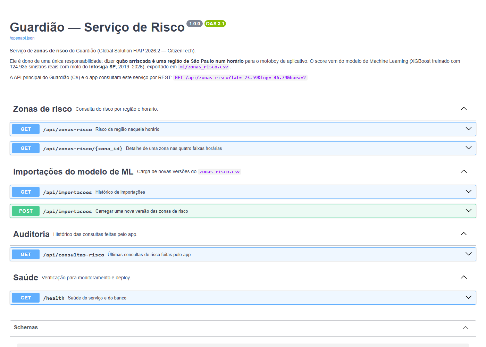
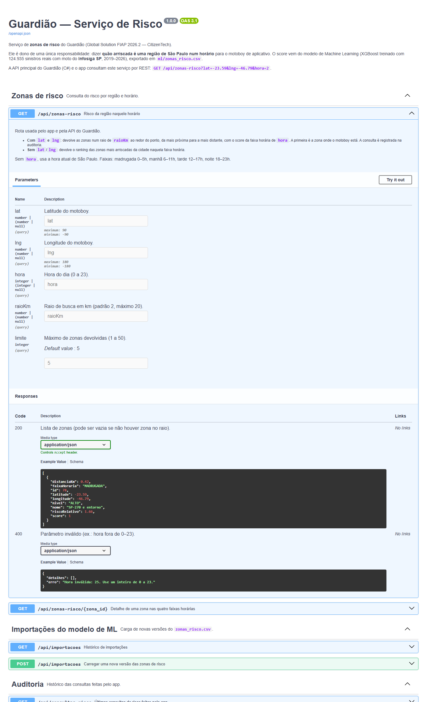
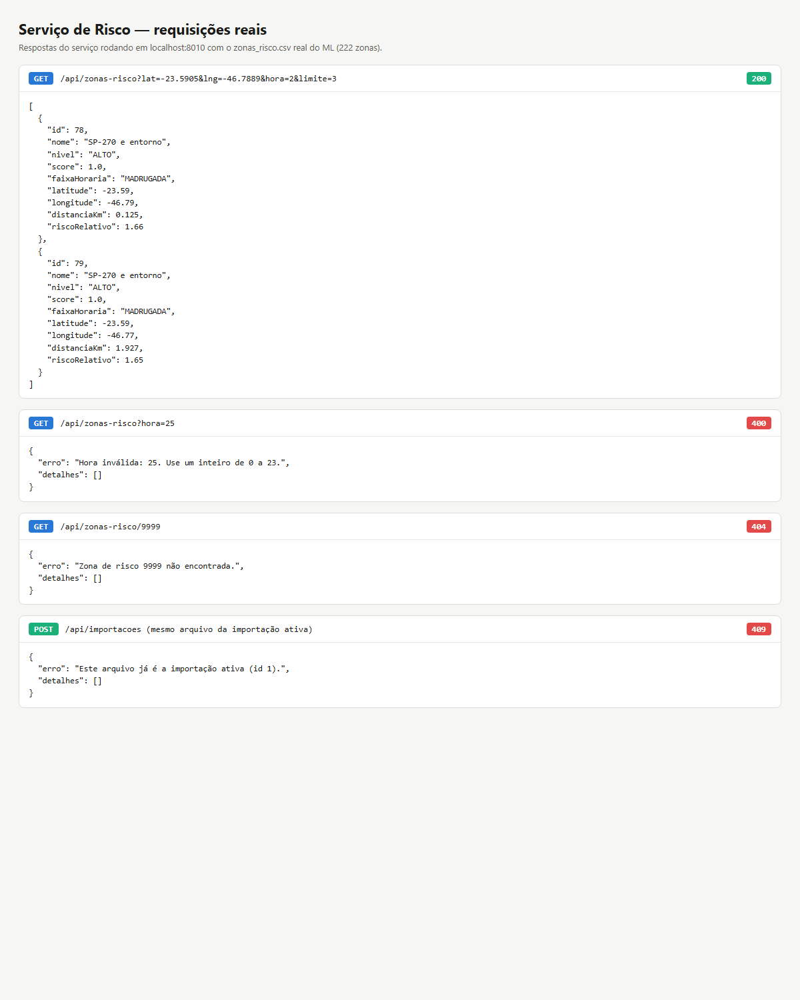
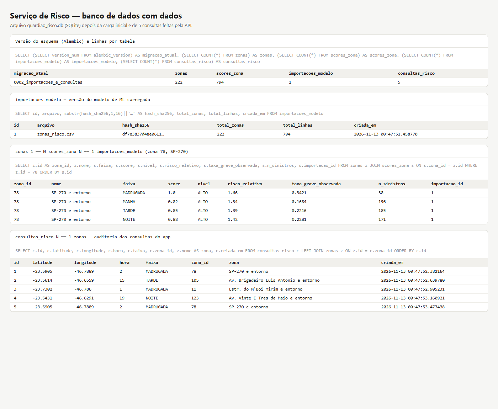
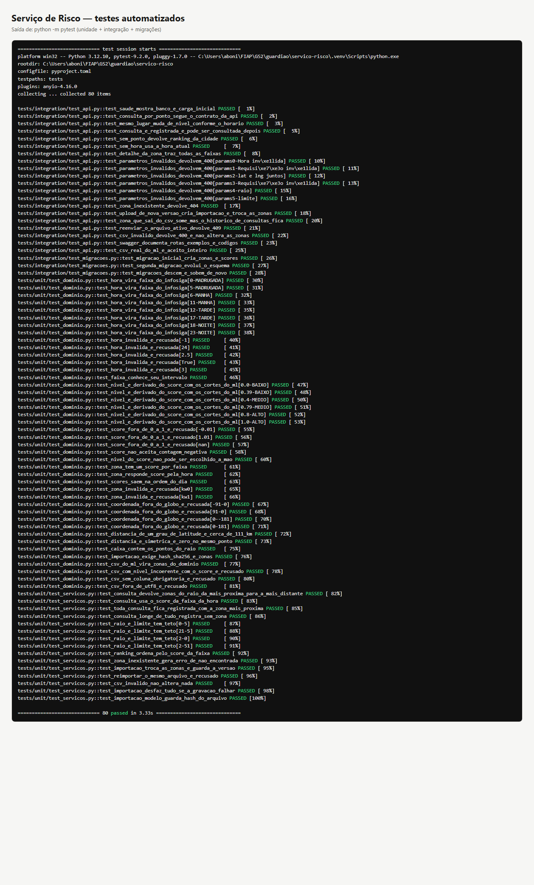

# Guardião — Serviço de Risco

**Arquitetura Orientada a Serviços (SOA) e Web Services · Global Solution FIAP 2026.2 · CitizenTech**

> **Integrantes:** Arthur Abonizio (RM555506) · Gabriel Padula (RM554907) · Rodrigo Nakata (RM556417)

## O que é

O Guardião protege o **motoboy de aplicativo em São Paulo**: uma caixinha na moto detecta a queda e pede socorro, e
o app avisa quais regiões são perigosas naquele horário.

Este serviço é **o backend das zonas de risco**. Ele tem uma única responsabilidade: dizer **quão arriscada é uma
região da cidade num horário**. O score vem do modelo de Machine Learning da equipe (XGBoost treinado com 124.935
sinistros reais com moto do **Infosiga SP**, 2019–2026), exportado em [`../ml/zonas_risco.csv`](../ml/zonas_risco.csv).

### Onde ele entra na solução (SOA na prática)

```
 ESP32 (queda) ──POST /api/ocorrencias──►┐
                                         │  API Guardião (C#, pasta api/)       ┌──────────────────────────┐
 App Expo ──────GET /api/zonas-risco────►├─ motoboys, contatos, ocorrências ───►│ Serviço de Risco (este)  │
          ◄────────────── JSON ──────────┘  repassa a consulta de risco  REST  │ FastAPI + SQLite/Postgres│
                                                                               └────────────▲─────────────┘
 Notebook de ML (ml/) ──── zonas_risco.csv ──── POST /api/importacoes ─────────────────────┘
```

- **Dois serviços com responsabilidades separadas**, conversando por REST/JSON. A API principal (C#) cuida de
  motoboys, contatos e ocorrências; este serviço cuida só do risco.
- **Contrato estável:** `GET /api/zonas-risco?lat=&lng=&hora=` devolve `[{ "id", "nome", "nivel", "score" }]`,
  exatamente o formato combinado no contrato da equipe (mais campos extras opcionais).
- **Troca de versão do modelo sem parar o serviço:** o ML gera um CSV novo e ele é carregado por `POST /api/importacoes`.

## Tecnologias

Python 3.12 · **FastAPI** (REST + Swagger/OpenAPI automático) · **SQLAlchemy 2.0** (ORM) · **Alembic** (migrações) ·
SQLite por padrão (PostgreSQL com a mesma configuração) · **pytest** (80 testes).

## Estruturação do domínio

Camadas: **API → Serviço → Repositório → Banco**. O domínio não conhece banco, HTTP nem CSV.

```
servico-risco/
├── app/
│   ├── domain/            ← regras de negócio puras
│   │   ├── entities.py        ZonaDeRisco, ScoreFaixa, Coordenada, ImportacaoModelo, ConsultaRisco
│   │   ├── enums.py           FaixaHoraria (hora → faixa), NivelRisco (score → nível)
│   │   ├── exceptions.py      DominioInvalido (400), ZonaNaoEncontrada (404), ImportacaoDuplicada (409)
│   │   └── repositories.py    interfaces (Protocol) dos repositórios e da unidade de trabalho
│   ├── services/          ← casos de uso
│   │   ├── zona_risco_service.py   consultar perto do motoboy, ranking, detalhe, auditoria
│   │   └── importacao_service.py   carregar nova versão do CSV numa transação
│   ├── infrastructure/    ← detalhes técnicos
│   │   ├── models.py          tabelas (ORM), separadas das entidades
│   │   ├── repositories.py    implementação SQLAlchemy + tradução ORM ↔ domínio
│   │   ├── csv_zonas.py       leitura e validação do zonas_risco.csv
│   │   ├── database.py        engine e sessão
│   │   └── migracoes.py       aplica as migrações por código
│   ├── api/               ← HTTP
│   │   ├── routers.py         rotas (só traduzem HTTP ↔ serviço)
│   │   ├── schemas.py         DTOs de saída (a entidade nunca sai direto na rota)
│   │   └── dependencies.py    injeção de dependência (sessão → unidade de trabalho → serviço)
│   ├── config.py          configuração por variável de ambiente
│   └── main.py            aplicação, tratamento de erros, inicialização
├── migrations/versions/   ← 0001_inicial.py, 0002_importacoes_e_consultas.py
├── tests/                 ← unit/ (domínio e serviços) e integration/ (API, banco, migrações)
└── docs/evidencias/       ← prints
```

**Regras que moram no domínio (e não no controller):**

| Regra | Onde |
|---|---|
| A hora vira faixa horária (madrugada 0–5, manhã 6–11, tarde 12–17, noite 18–23); hora fora de 0–23 é recusada | `FaixaHoraria.de_hora` |
| O nível **nunca é escolhido à mão**: é derivado do score (≥ 0,80 ALTO, ≥ 0,40 MEDIO), com os mesmos cortes do ML | `ScoreFaixa.nivel` / `NivelRisco.de_score` |
| Score, taxa observada e contagens têm limites válidos (0 a 1, não negativos) | `ScoreFaixa.__post_init__` |
| Uma zona tem **no máximo um score por faixa horária** | `ZonaDeRisco.adicionar_score` |
| Distância real (haversine) e caixa de busca ao redor do ponto | `Coordenada` |
| Importação é **tudo ou nada**: uma linha inválida (ex.: nível que não bate com o score) cancela o arquivo inteiro | `ler_zonas` + `ImportacaoService` |
| O mesmo arquivo não vira duas versões (hash SHA-256) | `ImportacaoService.importar` |
| Toda consulta do app é registrada para auditoria, **sem nenhum dado pessoal** do motoboy | `ZonaRiscoService.consultar_proximas` |

## Banco de dados

SQLite por padrão (arquivo `guardiao_risco.db`), com chaves estrangeiras ligadas. A string de conexão vem da
variável **`DATABASE_URL`** (ou do `.env`), nunca do código. Para PostgreSQL basta trocar a URL
(`postgresql+psycopg://...`) e instalar o driver.

```
importacoes_modelo 1 ──── N scores_zona N ──── 1 zonas 1 ──── N consultas_risco
   (versão do ML)         (score por faixa)      (região)       (auditoria do app)
```

| Tabela | Conteúdo | Regras no banco |
|---|---|---|
| `zonas` | id, nome, latitude, longitude | índices em latitude/longitude para a busca por caixa |
| `scores_zona` | zona_id, faixa, score, nivel, risco_relativo, taxa_grave_observada, n_sinistros, importacao_id | `UNIQUE(zona_id, faixa)`, `CHECK(score entre 0 e 1)`, FK com `ON DELETE CASCADE` |
| `importacoes_modelo` | arquivo, hash SHA-256, totais, data | índice no hash |
| `consultas_risco` | lat, lng, hora, faixa, zona_id, data | FK com `ON DELETE SET NULL` (o histórico fica se a zona sair do CSV) |

## Migrações

| Migração | O que faz |
|---|---|
| `0001_inicial` | cria `zonas` e `scores_zona` |
| `0002_importacoes_e_consultas` | evolui o esquema: cria `importacoes_modelo`, adiciona a coluna `scores_zona.importacao_id` (FK) e cria `consultas_risco` |

```bash
alembic upgrade head          # aplica todas
alembic downgrade -1          # volta uma
alembic current               # mostra a versão atual
alembic check                 # confere se os modelos batem com as migrações
```

As migrações também rodam sozinhas na inicialização do serviço (`APLICAR_MIGRACOES_NA_INICIALIZACAO=true`).

## Como rodar

Requisito: Python 3.12. Rode a partir da pasta `servico-risco/`.

```bash
python -m venv .venv
.venv\Scripts\activate              # Windows  (Linux/macOS: source .venv/bin/activate)
pip install -r requirements.txt
copy .env.example .env              # Linux/macOS: cp .env.example .env
alembic upgrade head
uvicorn app.main:app --port 8000
```

Na primeira subida o serviço importa o `../ml/zonas_risco.csv` (222 zonas × faixas = 794 linhas).

- **Swagger:** http://localhost:8000/docs
- **ReDoc:** http://localhost:8000/redoc
- **OpenAPI (JSON):** http://localhost:8000/openapi.json

## Endpoints

| Método | Rota | Para quê | Códigos |
|---|---|---|---|
| `GET` | `/api/zonas-risco?lat=&lng=&hora=&raioKm=&limite=` | Zonas ao redor do motoboy na faixa da hora (a 1ª é onde ele está). Sem `lat`/`lng`: ranking da cidade. Sem `hora`: hora atual de SP | 200, 400 |
| `GET` | `/api/zonas-risco/{id}` | Detalhe da zona nas 4 faixas, com a taxa real de graves | 200, 400, 404 |
| `POST` | `/api/importacoes` | Carrega nova versão do `zonas_risco.csv` (upload multipart; sem arquivo, recarrega o padrão) | 201, 400, 409 |
| `GET` | `/api/importacoes` | Histórico de versões do modelo | 200 |
| `GET` | `/api/consultas-risco?limite=` | Auditoria das últimas consultas | 200, 400 |
| `GET` | `/health` | Saúde do serviço e do banco | 200 |

Exemplo (dado real do ML: região da SP-270, Raposo Tavares, às 2h):

```bash
curl "http://localhost:8000/api/zonas-risco?lat=-23.5905&lng=-46.7889&hora=2&limite=1"
```

```json
[{ "id": 78, "nome": "SP-270 e entorno", "nivel": "ALTO", "score": 1.0, "faixaHoraria": "MADRUGADA",
   "latitude": -23.59, "longitude": -46.79, "distanciaKm": 0.125, "riscoRelativo": 1.66 }]
```

Erros sempre no mesmo formato: `{ "erro": "Hora inválida: 25. Use um inteiro de 0 a 23.", "detalhes": [] }`.
Erros de validação de parâmetro também saem como **400** (e não 422), e o Swagger documenta isso.

### Como a API em C# consome este serviço

```csharp
// Program.cs
builder.Services.AddHttpClient("risco", c => c.BaseAddress = new Uri(builder.Configuration["RiscoServiceUrl"]!));

// No serviço de zonas da API C#
var http = _httpFactory.CreateClient("risco");
var zonas = await http.GetFromJsonAsync<List<ZonaRiscoDto>>(
    $"/api/zonas-risco?lat={lat.ToString(CultureInfo.InvariantCulture)}&lng={lng.ToString(CultureInfo.InvariantCulture)}&hora={hora}");
```

## Testes automatizados

```bash
python -m pytest
```

**80 testes, todos passando** (~3 s):

| Arquivo | Tipo | O que cobre |
|---|---|---|
| `tests/unit/test_dominio.py` | unidade | faixa horária, nível pelo score, limites do score, um score por faixa, coordenadas e distância, leitura do CSV |
| `tests/unit/test_servicos.py` | unidade (repositórios falsos em memória) | ordem por distância, raio, auditoria, ranking, 404, importação tudo-ou-nada, rollback, duplicada |
| `tests/integration/test_api.py` | integração (API + SQLite + migrações) | contrato do JSON, consulta e depois leitura da auditoria, ranking, 400/404/409, upload de nova versão, CSV inválido não altera nada, Swagger documentado, **CSV real do ML aceito inteiro** |
| `tests/integration/test_migracoes.py` | integração | cada migração cria o que promete; sobe, desce e sobe de novo |

## Evidências

| | |
|---|---|
| **Swagger gerado pelo código** |  |
| **Rota principal documentada, com exemplo e códigos** |  |
| **Requisições reais (200, 400, 404, 409)** |  |
| **Banco com dados depois de consultas** |  |
| **Testes passando** |  |
